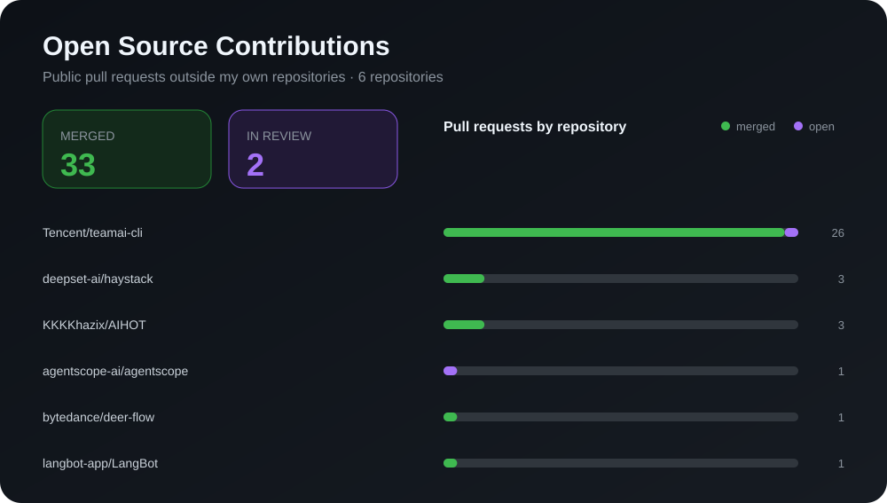

<h1 align="center">AI Application Engineering · LLM Agents · Evaluation</h1>

<strong>Agents that write and run their own code — and a harness that says whether the code was right</strong>

  

  I work on the parts of an LLM application that decide whether it survives real data: the loop that plans,
  writes code and runs it; the boundary that keeps that code contained; and the harness that turns
  "it looked right" into a number I can defend. Most of what I ship is a failure path someone forgot to write.

<!-- PROFILE_BADGES:START -->

  
  
  
  

<!-- PROFILE_BADGES:END -->

## What I Build

- 🤖 **Agents, Built Both Ways** — [DataChat](https://github.com/Smilewithoutfalling/datachat): one kernel, two control flows. A fixed `StateGraph` (planner → codegen → executor → reviewer → summarizer) with a conditional edge back from a failed run, and a ReAct loop where the model picks the tool and decides when it is done. Building both is how you learn which failures belong to the graph and which belong to the model
- 🧰 **Tool Calling With Damage Control** — the agent's only real power is executing Python, so it runs in a restricted namespace under a timeout, and every run lands in `runs.jsonl` with its code, output and error. Capability is granted one tool at a time, not as a blank cheque
- 🧪 **Evaluation Before Opinion** — a 50-case suite replayed through a deterministic comparator, an offline fake model so the tests never depend on a provider, and scores that survive a model swap
- ⚡ **Failure Paths As The Feature** — explicit timeouts, retry with backoff, per-run token accounting and a structured `AnalysisResult`, because an agent that works for three turns and dies on the thirtieth is not working
- 📦 **Shipped, Not Just Running** — React + TypeScript front end served by the agent itself, a Windows desktop installer built in CI as a downloadable artifact, and artifacts pinned under `outputs/` so nothing drifts with the launch directory

## Tech Stack

<strong>Agent runtime</strong>

  
  
  
  
  
  

<strong>Service &amp; state</strong>

  
  
  
  

<strong>Interface</strong>

  
  
  
  

<strong>Quality &amp; delivery</strong>

  
  
  
  
  

Also worked with: Docker · Redis · MySQL · PyTorch

<!-- OPEN_SOURCE_CONTRIBUTIONS:START -->
## Open Source Contributions

> Automatically updated daily · 35 merged · 0 in review · 6 repositories

### Merged Pull Requests

| Project | Contribution | PR |
|---|---|---|
| [agentscope-ai/agentscope](https://github.com/agentscope-ai/agentscope) | Ignored duplicate index tasks for documents that are already ready | [#3658](https://github.com/agentscope-ai/agentscope/pull/3658) |
| [Tencent/teamai-cli](https://github.com/Tencent/teamai-cli) | Delivered the user's files to the root the app actually launches from | [#1745](https://github.com/Tencent/teamai-cli/pull/1745) |
| [Tencent/teamai-cli](https://github.com/Tencent/teamai-cli) | Made `remove` fail loudly instead of silently succeeding when nothing matched | [#1741](https://github.com/Tencent/teamai-cli/pull/1741) |
| [Tencent/teamai-cli](https://github.com/Tencent/teamai-cli) | Surfaced a skipped skill in `--update-quality` and matched learnings by topic | [#1739](https://github.com/Tencent/teamai-cli/pull/1739) |
| [deepset-ai/haystack](https://github.com/deepset-ai/haystack) | Documented the pandas row-index assumption behind XLSX row numbering | [#13566](https://github.com/deepset-ai/haystack/pull/13566) |
| [Tencent/teamai-cli](https://github.com/Tencent/teamai-cli) | Documented the non-zero exit returned for an unreadable manifest | [#1734](https://github.com/Tencent/teamai-cli/pull/1734) |
| [Tencent/teamai-cli](https://github.com/Tencent/teamai-cli) | Returned a non-zero exit when a roles or projects edit is refused, not success | [#1731](https://github.com/Tencent/teamai-cli/pull/1731) |
| [deepset-ai/haystack](https://github.com/deepset-ai/haystack) | Clarified what `word_count_threshold` actually counts | [#13549](https://github.com/deepset-ai/haystack/pull/13549) |
| [Tencent/teamai-cli](https://github.com/Tencent/teamai-cli) | Made a failed self-update exit non-zero instead of reporting success | [#1703](https://github.com/Tencent/teamai-cli/pull/1703) |
| [Tencent/teamai-cli](https://github.com/Tencent/teamai-cli) | Persisted self-update failures to `debug.log` so they survive the terminal | [#1702](https://github.com/Tencent/teamai-cli/pull/1702) |

25 earlier merged pull requests

| Project | Contribution | PR |
|---|---|---|
| [langbot-app/LangBot](https://github.com/langbot-app/LangBot) | Throttled intermediate stream frames in WebSocket mode | [#2564](https://github.com/langbot-app/LangBot/pull/2564) |
| [Tencent/teamai-cli](https://github.com/Tencent/teamai-cli) | Recognised an origin-less `--dir` checkout by hashing its git root | [#1427](https://github.com/Tencent/teamai-cli/pull/1427) |
| [Tencent/teamai-cli](https://github.com/Tencent/teamai-cli) | Timed out a stalled `gh` org request instead of retrying it forever | [#1403](https://github.com/Tencent/teamai-cli/pull/1403) |
| [Tencent/teamai-cli](https://github.com/Tencent/teamai-cli) | Retried the session-pull temp cleanup that races `git gc` | [#1408](https://github.com/Tencent/teamai-cli/pull/1408) |
| [bytedance/deer-flow](https://github.com/bytedance/deer-flow) | Retargeted the label docs at `triage.yml` and guarded applied labels | [#7328](https://github.com/bytedance/deer-flow/pull/7328) |
| [deepset-ai/haystack](https://github.com/deepset-ai/haystack) | Validated `inputs_from_state` when a tool takes no inputs | [#13279](https://github.com/deepset-ai/haystack/pull/13279) |
| [Tencent/teamai-cli](https://github.com/Tencent/teamai-cli) | Reported an async command error as one line instead of a stack trace | [#1271](https://github.com/Tencent/teamai-cli/pull/1271) |
| [Tencent/teamai-cli](https://github.com/Tencent/teamai-cli) | Honoured both tool roots that Cursor CLI actually records | [#1165](https://github.com/Tencent/teamai-cli/pull/1165) |
| [Tencent/teamai-cli](https://github.com/Tencent/teamai-cli) | Added a config switch for the SessionStart merge-request hint | [#1117](https://github.com/Tencent/teamai-cli/pull/1117) |
| [Tencent/teamai-cli](https://github.com/Tencent/teamai-cli) | Made `doctor` prove the SessionStart hook answers, not just that it exists | [#1064](https://github.com/Tencent/teamai-cli/pull/1064) |
| [KKKKhazix/AIHOT](https://github.com/KKKKhazix/AIHOT) | Added an unread-only filter to the curated timeline | [#188](https://github.com/KKKKhazix/AIHOT/pull/188) |
| [Tencent/teamai-cli](https://github.com/Tencent/teamai-cli) | Pointed both guides at the renamed SessionStart check | [#1048](https://github.com/Tencent/teamai-cli/pull/1048) |
| [Tencent/teamai-cli](https://github.com/Tencent/teamai-cli) | Delivered the ZCode SessionStart hook through a Node launcher | [#1047](https://github.com/Tencent/teamai-cli/pull/1047) |
| [Tencent/teamai-cli](https://github.com/Tencent/teamai-cli) | Accepted tool roots nested below `~/.config/<name>` | [#1017](https://github.com/Tencent/teamai-cli/pull/1017) |
| [KKKKhazix/AIHOT](https://github.com/KKKKhazix/AIHOT) | Removed a `modelStops` field from the alert config that nothing read | [#186](https://github.com/KKKKhazix/AIHOT/pull/186) |
| [Tencent/teamai-cli](https://github.com/Tencent/teamai-cli) | Kept the token out of the clone's remote URL | [#994](https://github.com/Tencent/teamai-cli/pull/994) |
| [Tencent/teamai-cli](https://github.com/Tencent/teamai-cli) | Vetoed a Swift bare call only inside a type body | [#966](https://github.com/Tencent/teamai-cli/pull/966) |
| [Tencent/teamai-cli](https://github.com/Tencent/teamai-cli) | Stopped `.gitignore` self-healing under `--dry-run` | [#944](https://github.com/Tencent/teamai-cli/pull/944) |
| [Tencent/teamai-cli](https://github.com/Tencent/teamai-cli) | Pinned the binding fix with a test that fails without it | [#943](https://github.com/Tencent/teamai-cli/pull/943) |
| [Tencent/teamai-cli](https://github.com/Tencent/teamai-cli) | Collected Swift shadowing from binding positions | [#928](https://github.com/Tencent/teamai-cli/pull/928) |
| [KKKKhazix/AIHOT](https://github.com/KKKKhazix/AIHOT) | Made the Markdown export filename follow the site's own identity | [#16](https://github.com/KKKKhazix/AIHOT/pull/16) |
| [Tencent/teamai-cli](https://github.com/Tencent/teamai-cli) | Resolved Swift symbols across files in the same module | [#847](https://github.com/Tencent/teamai-cli/pull/847) |
| [Tencent/teamai-cli](https://github.com/Tencent/teamai-cli) | Threaded `dryRun` into the queue lock so a preview stops creating work | [#896](https://github.com/Tencent/teamai-cli/pull/896) |
| [Tencent/teamai-cli](https://github.com/Tencent/teamai-cli) | Threaded `dryRun` through the loaders pull, push and status paths | [#866](https://github.com/Tencent/teamai-cli/pull/866) |
| [Tencent/teamai-cli](https://github.com/Tencent/teamai-cli) | Added Swift support to the AST and heuristic code-knowledge tracks | [#842](https://github.com/Tencent/teamai-cli/pull/842) |

### Pull Requests In Review

_No open external pull requests._
<!-- OPEN_SOURCE_CONTRIBUTIONS:END -->

## Contribution Dashboard

  

